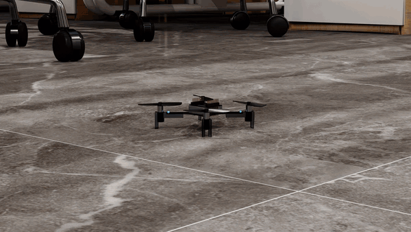
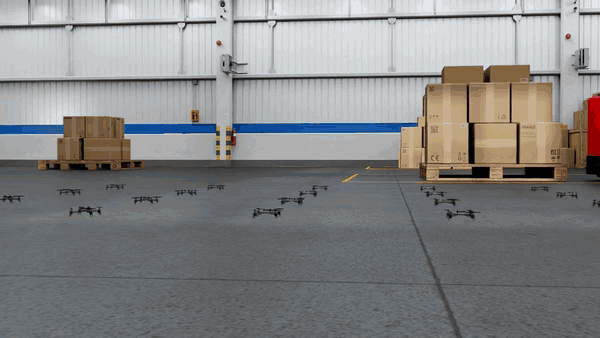

# Crazyflie Swarm with Crazyswarm2 and Isaac Sim

Formation flights of Crazyflie 2.1 swarms with Crazyswarm2 and NVIDIA Isaac Sim. The Crazyswarm2 simulation server runs the Crazyflie firmware's trajectory planner and controller in the loop, and Isaac Sim simulates the drone dynamics. Two shows are included: six drones in an open-plan office and twenty drones in a warehouse.





## Method

| Component | Implementation |
|---|---|
| Swarm control | Crazyswarm2 (ROS 2 Humble). A mission uploads one piecewise polynomial trajectory per drone, takes off, starts all trajectories with one broadcast command and lands |
| Onboard software | Crazyflie firmware 2025.12.1 built as Python bindings: high-level commander, trajectory planner and Mellinger controller, run in the loop by the Crazyswarm2 simulation server |
| Dynamics | Isaac Sim (PhysX) rigid bodies stepped at 1 kHz in lockstep with the firmware over a local socket. Rotor thrust from the Crazyswarm2 motor identification, first-order motor lag (12.5 ms spin-up, 25 ms spin-down), 29 g mass and the identified Crazyflie 2 inertia. Simulation time is published on `/clock` |
| Choreography | Formations and transitions planned offline: drone-to-slot assignment by minimum sum of squared distances (CAPT), minimum-jerk transitions, and a fit with 7th-order polynomial pieces that is C2-continuous and stays within the 31 pieces of the Crazyflie trajectory memory |
| Validation | Clearance of every trajectory sample against a 3D distance map built from the scene's mesh faces, and pairwise separation between the drones |
| Drone model | MuJoCo Menagerie Crazyflie 2 meshes with Crazyflie 2.1 materials and LEDs, and each propeller as a separate rotor prim |

The drones use the simulator's ground-truth state in place of a motion-capture system. Aerodynamic interaction between drones (downwash) is not modelled.

| Show | Drones | Recorded flight | Tracking error, mean / max | Clearance, min | Separation, min |
|---|---|---|---|---|---|
| `office6` | 6 | 71 s | 3.0 / 4.8 cm | 0.40 m | 0.42 m |
| `warehouse20` | 20 | 92 s | 3.0 / 4.7 cm | 0.50 m | 0.40 m |

## Files

- `ros/run_server.py`: Crazyswarm2 simulation server with a given drone list and physics backend
- `ros/isaac_backend.py`: Crazyswarm2 simulation backend that steps Isaac Sim and publishes simulation time
- `isaac/physics_server.py`: Isaac Sim physics of the swarm (motor model, thrust and body torques) and flight recording
- `isaac/build_cf21_usd.py`: Crazyflie 2.1 visual and physics USD assets
- `plan/choreo.py`: formations, CAPT transitions, polynomial fitting in the Crazyflie trajectory format, validation
- `plan/show_office6.py`, `plan/show_warehouse20.py`: the two shows
- `plan/scene_voxels.py`, `plan/usd_geometry.py`: 3D clearance map of a scene
- `missions/fly_plan.py`: Crazyswarm2 mission that flies a planned show
- `run_flight.sh`: starts the physics server, the Crazyswarm2 server and the mission, and records the flight
- `plans/`, `config/`: planned trajectories (one CSV per drone) and Crazyswarm2 drone lists of both shows
- `setup_ros.sh`: uv environment for the ROS 2 side and the firmware bindings
- `fetch_assets.sh`: download of the Crazyflie meshes and of the two scenes

## Requirements

Ubuntu 22.04 with ROS 2 Humble and the Crazyswarm2 packages, Isaac Sim 6.1 and Isaac Lab 3.0 (`release/3.0.0` branch), [uv](https://docs.astral.sh/uv/), and the Hugging Face CLI for the scene downloads. Tested on an NVIDIA GPU with 16 GB of memory.

```bash
sudo apt install ros-humble-crazyflie ros-humble-crazyflie-sim ros-humble-crazyflie-py swig build-essential
git clone -b release/3.0.0 https://github.com/isaac-sim/IsaacLab.git ~/IsaacLab
cd ~/IsaacLab && uv sync --extra isaacsim
```

## Usage

```bash
git clone https://github.com/prakash-aryan/crazyflie-swarm-isaac.git
cd crazyflie-swarm-isaac
export OMNI_KIT_ACCEPT_EULA=YES

./setup_ros.sh                                                  # ROS 2 side and firmware bindings
./fetch_assets.sh crazyflie                                     # Crazyflie meshes (1 MB)
~/IsaacLab/.venv/bin/python isaac/build_cf21_usd.py

./run_flight.sh config/office6.yaml plans/office6 runs/office6.npz
./run_flight.sh config/warehouse20.yaml plans/warehouse20 runs/warehouse20.npz --stagger 0 --idle 2
```

`run_flight.sh` uses the Isaac Lab Python given by `ISAAC_PYTHON` (default `~/IsaacLab/.venv/bin/python`). The recording holds the drone states, motor speeds and setpoints at 250 Hz. `--stagger 0` takes off and lands the whole swarm with broadcast commands; otherwise the drones take off one after another.

Planning a show again requires its scene for the clearance map:

```bash
./fetch_assets.sh office                                        # ~24 GB download
~/IsaacLab/.venv/bin/python plan/scene_voxels.py --out maps/office_voxels.npz \
    --scene assets/grscenes/scenes/GRScenes-100/commercial_scenes/scenes/MWF4WLIKTIFZIAABAAAAAEA8_usd/start_result_interaction.usd
~/IsaacLab/.venv/bin/python plan/show_office6.py

./fetch_assets.sh warehouse                                     # ~14 GB
~/IsaacLab/.venv/bin/python plan/scene_voxels.py --out maps/warehouse_voxels.npz \
    --scene assets/simready_warehouse/physical_ai_simready_warehouse_01.usd \
    --window -48 -72 -22 -47 --ceiling 9 --no-floor-mask
~/IsaacLab/.venv/bin/python plan/show_warehouse20.py
```

If a numpy installation in `~/.local` shadows the one in the Isaac Lab environment, set `PYTHONNOUSERSITE=1`.

## Credits

- [Crazyswarm2](https://github.com/IMRCLab/crazyswarm2) (MIT): ROS 2 stack, simulation server and motor identification
- [Crazyflie firmware](https://github.com/bitcraze/crazyflie-firmware) (GPL-3.0): trajectory planner and controllers, built locally
- [MuJoCo Menagerie Crazyflie 2](https://github.com/google-deepmind/mujoco_menagerie/tree/main/bitcraze_crazyflie_2) (MIT): drone meshes
- [NVIDIA PhysicalAI SimReady Warehouse 01](https://huggingface.co/datasets/nvidia/PhysicalAI-SimReady-Warehouse-01) (CC-BY-4.0): warehouse scene
- [GRScenes](https://huggingface.co/datasets/InternRobotics/GRScenes) (CC BY-NC-SA 4.0): office scene
- [Isaac Lab](https://github.com/isaac-sim/IsaacLab) (BSD-3-Clause): simulation framework
- [RotorS](https://github.com/ethz-asl/rotors_simulator) (Apache-2.0): motor time constants of the Crazyflie 2 model
- J. Förster, "System Identification of the Crazyflie 2.0 Nano Quadrocopter", ETH Zurich, 2015: inertia
